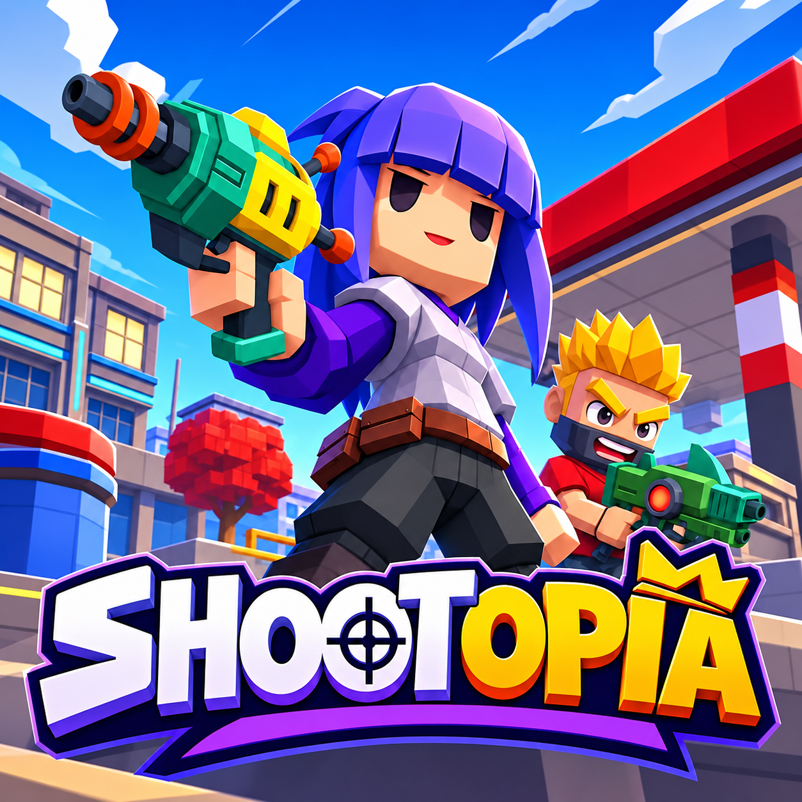
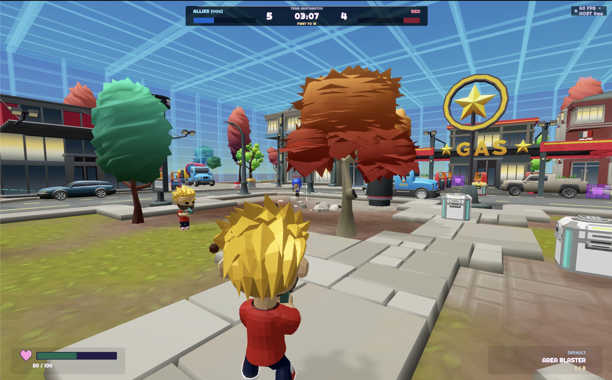
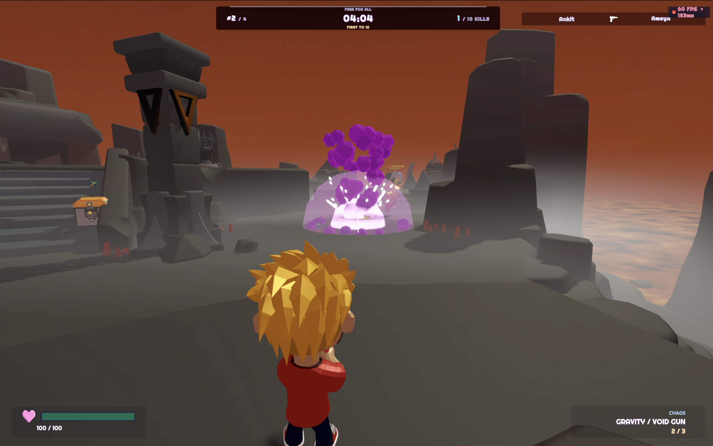
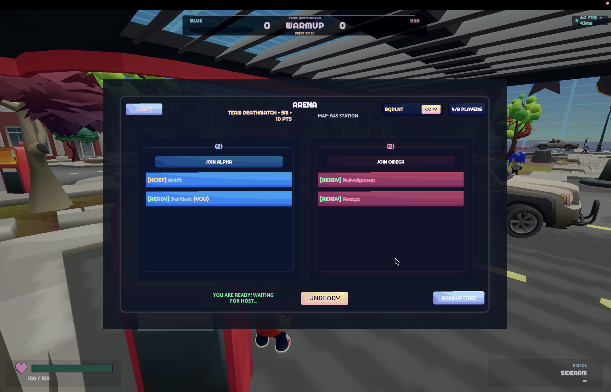
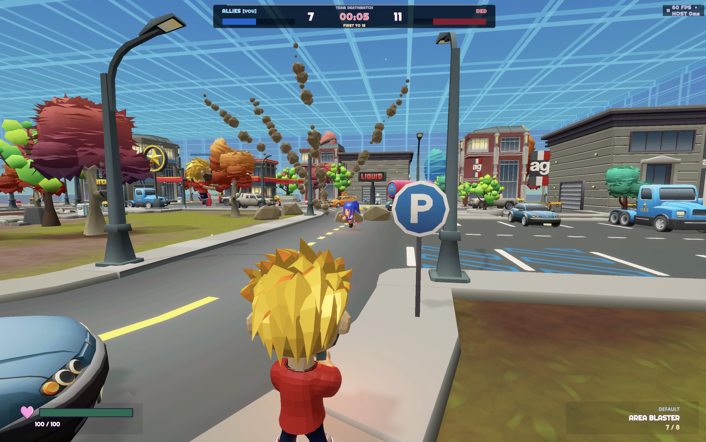
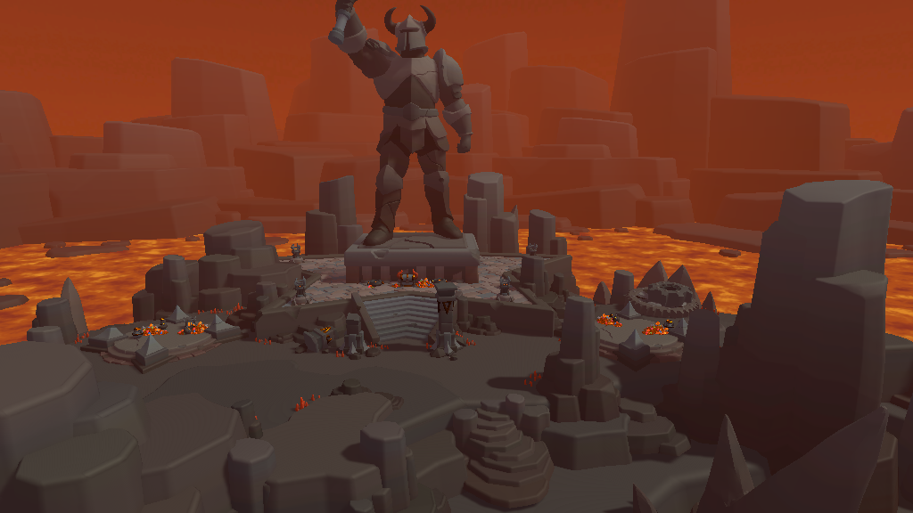
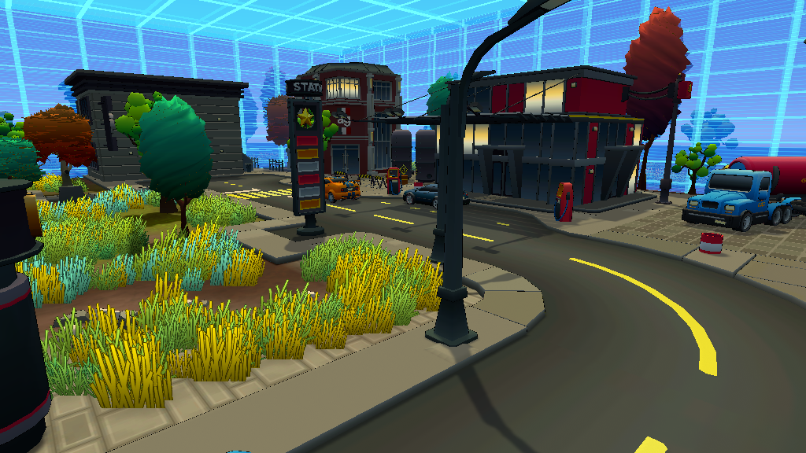

  

<h1 align="center">Shootopia</h1>

  <strong>A fast-paced, chaotic 3D multiplayer third-person arena shooter built for pure fun and unforgettable game nights.</strong>

  
  
  
  
  

  
  

---

## 🚀 Welcome to Shootopia!

Welcome to **Shootopia**! A free, fast-paced 3D multiplayer third-person shooter made for pure fun and chaotic game nights with friends. It runs right in your web browser—no downloads required—so you and your friends can jump into a match on desktop, laptop, or mobile instantly.

This is a genuine passion project built entirely using free community assets. It's Day 1 of our launch, so we're keeping things simple, accessible, and fun!

---

## 🎬 Gameplay Showcase

  <video src="Screenshots/Gameplay_GasStation.mp4" width="100%" controls autoplay loop muted></video>

  🎥 <strong>Gameplay Video Clips:</strong> 
  <a href="Screenshots/Gameplay_GasStation.mp4"><strong>Gas Station Shootout (MP4)</strong></a> • 
  <a href="Screenshots/Gameplay_InfernoArena.mp4"><strong>Inferno Arena Battle (MP4)</strong></a>

---

## 📸 In-Game Screenshots

<table>
  <tr>
    <td width="50%" align="center">
      
       
      <strong>⚔️ Team Deathmatch at The Gas Station</strong>
    </td>
    <td width="50%" align="center">
      
       
      <strong>🌌 Void Blaster Gravitational Singularity</strong>
    </td>
  </tr>
  <tr>
    <td width="50%" align="center">
      
       
      <strong>👥 10-Player Lobby & Team Matchmaking</strong>
    </td>
    <td width="50%" align="center">
      
       
      <strong>💥 Chaotic Firefights & Particle FX</strong>
    </td>
  </tr>
</table>

---

## 📥 Play Online or Download

You can jump straight into the game via WebGL in your browser or grab the dedicated native downloads here:

🎮 **[Play WebGL or Download on itch.io (https://mastersk.itch.io/shootopia)](https://mastersk.itch.io/shootopia)**

While you can play directly in your browser, we strongly recommend downloading the dedicated executable version for the best experience. Shootopia is available for **Android**, **Windows**, and **macOS**.

> [!TIP]
> **Why native builds?** The downloadable builds offer superior performance, rock-solid frame rates, and more reliable network synchronization. The WebGL browser version is super convenient for jumping into a quick match with friends on the fly, but may experience additional delays or synchronization issues on slower or unstable internet connections.

---

## 🎮 How to Play

The gameplay is simple: spawn into the arena, sprint to the nearest loot boxes scattered across the map, grab whatever weapon pops out, and start blasting!

* **Free-For-All (FFA)**: Total chaos. Every player for themselves—rack up kills, survive the frenzy, and climb to the top of the leaderboard.
* **Team Deathmatch (TDM)**: Red vs. Blue. Team up, watch each other's backs, coordinate pushes, and hit the team score target together.
* **Custom Match Settings**: Hosting a match? You have full control to customize the kill goal, match duration, and player count (supporting up to **10 players per room**).

---

## 🗺️ Current Maps

Battle it out across two handcrafted battlegrounds, each demanding different tactics:

<table>
  <tr>
    <td width="50%" align="center">
      
       
      <strong>🔥 Inferno Arena (Sector Alpha)</strong>
    </td>
    <td width="50%" align="center">
      
       
      <strong>⛽ The Gas Station</strong>
    </td>
  </tr>
  <tr>
    <td valign="top">
      A sci-fi dungeon fortress suspended directly over bubbling lava. Features jump pads and vertical combat platforms—watch your step, because falling into the lava is an instant fiery knockout!
    </td>
    <td valign="top">
      An abandoned, dusty outpost in the middle of nowhere surrounded by a containment zone. Perfect for rooftop snipers, close-quarters flanking around fuel pumps, and sudden ambushes.
    </td>
  </tr>
</table>

---

## 🔫 The Arsenal

Loot chests drop all kinds of fun weapons and tactical toys. A few favorites to look out for:

* ❄️ **Freeze Gun**: Turn your friends into solid blocks of ice and stop them dead in their tracks.
* 🔥 **Flame Gun**: Spray continuous fire to light up opponents with lingering burn damage.
* 🌌 **Void Blaster**: Shoots gravity orbs that pull nearby players inward before blowing up.
* ⚡ **TrickShot Gun**: Bounces high-speed plasma shots off walls and ceilings for ridiculous trick shots.
* 🎯 **Sniper Rifle, Grenades, Shields & More**: Long-range scopes, bounce grenades, deployable force fields, and smoke cover.

---

## 🛠️ Tech Stack & Under the Hood

Shootopia was built as an ambitious, modern multiplayer project engineered to provide low-friction cross-platform access across the web and native hardware.

### ⚙️ Core Engine & Rendering
* **Unity 6 (`6000.3.9f1`)**: Leveraging the latest Unity 6 engine features for optimized runtime performance and multi-platform compilation.
* **Universal Render Pipeline (URP 17.3.0)**: Delivers clean visual styling, balanced lighting, and lightweight post-processing calibrated to run smoothly across browser WebGL, mobile chips, and high-refresh desktop monitors.
* **Visual Effect Graph (VFX Graph) & Custom Shaders**: Custom Shader Graph materials and GPU-accelerated particle effects driving projectile trails, weapon muzzle blasts, cryogenic freezing overlays, and fire particles.
* **Cinemachine (3.1.7)**: Dynamic third-person camera management featuring responsive orbital follow, smooth shoulder switching, and precision zoom for Aim-Down-Sights (ADS).

### 🌐 Multiplayer Architecture & Networking
* **Unity Netcode for GameObjects (NGO 2.13.0)**: Powers the authoritative networked game state, player synchronization, weapon handling, and match lifecycle.
* **Unity Transport (UTP) with Unity Gaming Services (UGS) Relay & Lobby**:
  * Frictionless cloud matchmaking: Players can host and join rooms via simple lobby codes or matchmaking without needing complex port-forwarding or static IPs.
  * UGS Relay relays UDP packets securely between peers across varying NAT types.
* **Local LAN Discovery (`LanDiscoveryManager`)**:
  * An integrated UDP broadcasting system that allows devices on the same local network (Wi-Fi/LAN) to automatically discover and join active sessions without internet access.
* **Lag Compensation & Client Prediction**:
  * Client-side prediction (`ClientNetworkTransform`) provides immediate local movement and responsive aim.
  * Server-validated hit registration and lag compensation buffers keep high-speed projectile exchanges fair and snappy, even on varying network conditions.

### 🖥️ User Interface & Input Systems
* **Unity UI Toolkit (UXML & USS)**:
  * Hardware-accelerated, flexible UI system powering the Main Menu, Custom Match settings, Waiting Room/Lobby, and HUD.
  * Fully scalable styling that automatically adapts between desktop displays and mobile touch screens.
* **Unity New Input System (1.18.0)**:
  * Unified input handling supporting Keyboard & Mouse, Gamepads/Controllers, and Touch screen controls with integrated mobile haptics (`MobileHapticsManager`).

### ⚡ Optimization & Memory Management
* **Global Object Pooling (`GlobalPoolManager`)**:
  * Pre-allocates and recycles projectiles, explosions, impact sparks, and audio sources.
  * Eliminates runtime garbage collection (GC) spikes during heavy firefights, ensuring consistent 60+ FPS on mobile and WebGL.
* **Adaptive Device Profiling (`DeviceProfileManager`)**:
  * Dynamically tunes graphic fidelity, target frame rates, and touch control layouts based on whether the game is running on a high-end desktop, mobile device, or inside a browser canvas.

---

## 💬 Day 1 Launch & Future Plans

We haven't done anything crazy yet—this is just the beginning! We built this game out of love for classic arcade party shooters and fun gaming sessions with friends.

We already have plans for:
- 🗺️ **New Maps** with unique environmental hazards
- 🕹️ **Fresh Game Modes**
- 💥 **More Weapons & Tactical Pickups**
- 🎨 **Extra Character Styles & Customizations**

Since this is our very first release, we would absolutely love to hear your feedback, reviews, and bug reports. Drop a comment with what you loved, what felt clunky, and what features you'd like to see next!

---

  <strong>Grab a friend, share the link, and have fun in Shootopia!</strong>  
  👉 <a href="https://mastersk.itch.io/shootopia"><strong>Play WebGL or Download on itch.io</strong></a>

